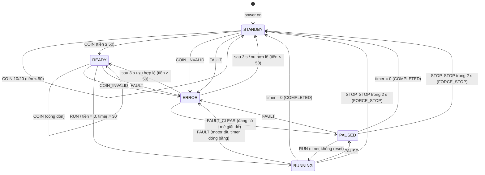

# 02 – Thiết kế máy trạng thái (FSM)

## 1. Các trạng thái

| Trạng thái | Ý nghĩa | RLED | BLED | Motor | Timer 30' |
|---|---|---|---|---|---|
| `STANDBY` | Chờ khách, tiền < 50c | **SÁNG** | tắt | tắt | – |
| `READY` | Đủ tiền (≥ 50c), chờ RUN | tắt | **SÁNG** | tắt | – |
| `RUNNING` | Đang giặt | tắt | **NHẤP NHÁY** | **chạy** | đếm |
| `PAUSED` | Tạm dừng | tắt | **SÁNG** | tắt | **vẫn đếm** |
| `ERROR` | Xu sai / lỗi phần cứng | **NHẤP NHÁY** | tắt | tắt | (lỗi HW: đóng băng) |

Bất biến (được test ngẫu nhiên 200 000 bước ở TC52):
- Luôn có **đúng 1 LED** đang hoạt động (sáng hoặc nhấp nháy).
- Motor chạy ⇔ trạng thái `RUNNING`.
- `RUNNING/PAUSED` ⇒ tiền = 0 và timer > 0.
- `STANDBY` ⇒ tiền < 50; `READY` ⇒ tiền ≥ 50.

## 2. Sơ đồ chuyển trạng thái



> [!NOTE]
> `ERROR` có 2 "trạng thái con" phân biệt bằng biến `error`:
> `WM_ERR_INVALID_COIN` (tự hết sau 3 s) và `WM_ERR_HW_FAULT` (chỉ hết khi có `FAULT_CLEAR`).
> Khi lỗi HW được xoá mà không có mẻ giặt dở thì về `STANDBY`/`READY` theo số tiền.

## 3. Bảng chuyển trạng thái đầy đủ (6 × 9 = 54 cặp)

Ký hiệu: `trạng thái mới / kết quả trả về`. **Toàn bộ bảng này được kiểm tra
tự động ở TC44–TC49.**

| Trạng thái \ Sự kiện | COIN_10 | COIN_20 | COIN_50 | COIN_INVALID | RUN | PAUSE | STOP | FAULT | FAULT_CLEAR |
|---|---|---|---|---|---|---|---|---|---|
| **STANDBY** (0c) | STANDBY/OK | STANDBY/OK | READY/OK | ERROR/REJECTED | –/IGNORED | –/IGNORED | –/IGNORED | ERROR/OK | –/IGNORED |
| **READY** (50c) | READY/OK | READY/OK | READY/OK | ERROR/REJECTED | **RUNNING/OK** | –/IGNORED | –/IGNORED | ERROR/OK | –/IGNORED |
| **RUNNING** | –/REJECTED | –/REJECTED | –/REJECTED | –/REJECTED | –/IGNORED | **PAUSED/OK** | –/STOP_ARMED ¹ | ERROR/OK | –/IGNORED |
| **PAUSED** | –/REJECTED | –/REJECTED | –/REJECTED | –/REJECTED | **RUNNING/OK** | –/IGNORED | –/STOP_ARMED ¹ | ERROR/OK | –/IGNORED |
| **ERROR** (xu sai) | STANDBY/OK | STANDBY/OK | READY/OK | –/REJECTED ² | –/IGNORED | –/IGNORED | –/IGNORED | ERROR/OK ³ | –/IGNORED |
| **ERROR** (lỗi HW) | –/REJECTED | –/REJECTED | –/REJECTED | –/REJECTED | –/IGNORED | –/IGNORED | –/IGNORED | –/IGNORED | **STANDBY/OK** ⁴ |

¹ Lần STOP thứ 2 trong vòng 2 s → `STANDBY/OK` (force stop).
² Khởi động lại 3 s báo lỗi.  ³ Lỗi HW ghi đè lỗi xu.  ⁴ Hoặc `READY`/`PAUSED` tuỳ tiền và mẻ giặt dở.

## 4. Sự kiện theo thời gian (`wm_tick`, mỗi 10 ms)

| Trạng thái | Xử lý mỗi tick |
|---|---|
| Mọi trạng thái | Bộ tạo nhấp nháy: đảo pha mỗi 50 tick (500 ms) |
| RUNNING, PAUSED | `remaining_ticks--`; = 0 → kết thúc (COMPLETED) → STANDBY |
| RUNNING, PAUSED | Nếu STOP đang "armed": `stop_window_ticks--`; = 0 → huỷ armed |
| ERROR (xu sai) | `error_ticks--`; = 0 → về STANDBY/READY |
| ERROR (lỗi HW) | Không làm gì (đóng băng) |

## 5. Biểu đồ thời gian ví dụ

```
t(s):   0    1    2         ...        1800
coin50  |
RUN          |
state   STBY RDY  RUNNING ................ STBY
RLED    ████ ____ ________________________ ████
BLED    ____ ████ █_█_█_█_█_█_█_█_█_█_█_█_ ____
motor   ____ ____ ████████████████████████ ____
credit  0    50   0 (tiền thừa không trả)
```

## 6. Ghi chú hiện thực

- `enter_state()` reset bộ nhấp nháy khi đổi trạng thái → LED luôn bắt đầu bằng pha **SÁNG**
  (giúp người dùng thấy phản hồi tức thì và giúp test chính xác đến từng tick).
- Thứ tự xử lý trong 1 tick của lớp app: `FAULT` → `COIN` → `STOP` → `PAUSE` → `RUN` → `wm_tick()`.
  STOP được xử lý trước để yêu cầu an toàn không bị trễ.
