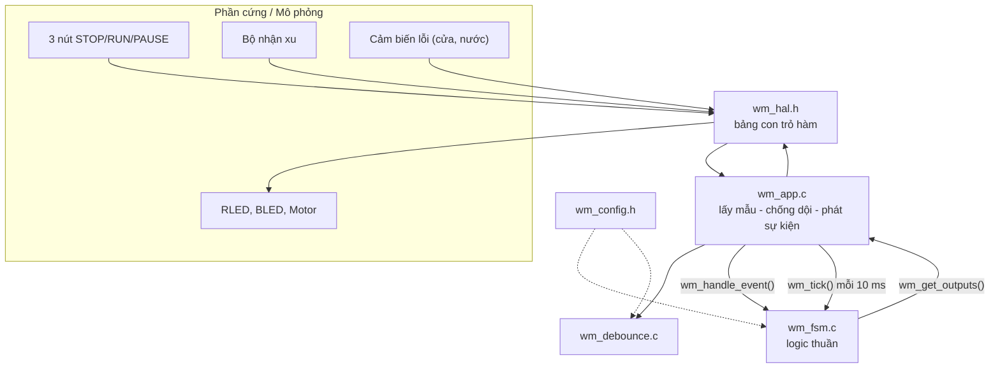

# 03 – Kiến trúc mã nguồn

## 1. Kiến trúc phân lớp



| Lớp | File | Phụ thuộc phần cứng? | Được test bởi |
|---|---|---|---|
| Cấu hình | `wm_config.h` | Không | – |
| Logic | `wm_fsm.h/.c` | **Không** | TC01–TC52 |
| Chống dội | `wm_debounce.h/.c` | Không | TC53–TC55 |
| Ứng dụng | `wm_app.h/.c` | Không (qua HAL) | TC56–TC64 (HAL giả) |
| HAL | `wm_hal.h` | Giao diện | – |
| Board | *(người dùng viết)* | **Có** | Trên phần cứng thật |

Nhờ tách lớp, **cùng một file `wm_fsm.c`** được biên dịch cho:
bộ test tự động, chương trình mô phỏng bàn phím và vi điều khiển thật.

## 2. Mô hình thực thi: Time-Triggered

Hệ thống được thiết kế theo kiểu **time-triggered** (chu kỳ cố định 10 ms):

```c
volatile bool g_tick_flag;

void TIMER_IRQHandler(void) {      /* ngắt timer 10 ms */
    g_tick_flag = true;
}

int main(void) {
    board_init();
    wm_app_init(&app, &board_hal);
    for (;;) {
        if (g_tick_flag) {
            g_tick_flag = false;
            wm_app_tick(&app);       /* đọc input -> FSM -> ghi output */
        }
        /* có thể vào chế độ ngủ (WFI) để tiết kiệm năng lượng */
    }
}
```

Mỗi lần `wm_app_tick()`:
1. Đọc đường lỗi, chống dội → sự kiện `FAULT` / `FAULT_CLEAR`.
2. Đọc bộ nhận xu → `COIN_10/20/50` hoặc `COIN_INVALID` (mọi giá trị khác).
3. Đọc 3 nút, chống dội → mỗi lần nhấn sinh **đúng 1** sự kiện (không auto-repeat).
4. Gọi `wm_tick()`: timer 30', cửa sổ STOP 2 s, timeout lỗi 3 s, nhấp nháy.
5. Ghi RLED/BLED/Motor qua HAL (chỉ ghi khi giá trị thay đổi).

## 3. Các API chính

```c
/* wm_fsm.h */
void          wm_init(wm_ctx_t *ctx);
wm_result_t   wm_handle_event(wm_ctx_t *ctx, wm_event_t ev);
void          wm_tick(wm_ctx_t *ctx);
wm_state_t    wm_get_state(const wm_ctx_t *ctx);
wm_outputs_t  wm_get_outputs(const wm_ctx_t *ctx);   /* rled, bled, motor */
uint32_t      wm_get_remaining_seconds(const wm_ctx_t *ctx);

/* wm_app.h */
bool          wm_app_init(wm_app_t *app, const wm_hal_t *hal);
void          wm_app_tick(wm_app_t *app);
```

`wm_handle_event()` trả về `wm_result_t` (`OK`, `IGNORED`, `COIN_REJECTED`,
`STOP_ARMED`, `INVALID_ARG`) – rất tiện cho việc kiểm thử và ghi log.

## 4. Các kỹ thuật lập trình nhúng đã áp dụng

| Kỹ thuật | Ở đâu | Lợi ích |
|---|---|---|
| Không `malloc`, không float | Toàn bộ `src/` | Phù hợp MCU nhỏ, không phân mảnh bộ nhớ |
| Thời gian thực thi hữu hạn | Mọi hàm | Gọi được từ ngắt, đáp ứng thời gian thực |
| Trạng thái gói trong `struct` | `wm_ctx_t` | Không biến toàn cục, test độc lập, chạy được nhiều máy |
| HAL bằng con trỏ hàm | `wm_hal.h` | Đổi board không phải sửa logic |
| Debounce bằng bộ đếm | `wm_debounce.c` | Lọc dội 5–20 ms của nút cơ khí |
| Kiểm tra cấu hình lúc biên dịch | `#error` trong `wm_config.h` | Bắt lỗi cấu hình sớm |
| Phòng thủ | Kiểm tra `NULL`, sự kiện ngoài phạm vi, `state` hỏng → reset an toàn | Chịu lỗi bộ nhớ/nhiễu |
| Ghi output khi thay đổi | `write_outputs()` | Giảm truy cập bus/GPIO |

## 5. Đưa lên vi điều khiển thật (ví dụ STM32 HAL)

Chỉ cần viết **một file board** điền bảng `wm_hal_t`:

```c
static bool     brd_btn(wm_button_id_t id) {
    static const uint16_t pin[] = { STOP_Pin, RUN_Pin, PAUSE_Pin };
    return HAL_GPIO_ReadPin(BTN_GPIO_Port, pin[id]) == GPIO_PIN_RESET; /* active-low */
}
static uint16_t brd_coin(void)        { return coin_acceptor_get_value(); }
static bool     brd_fault(void)       { return HAL_GPIO_ReadPin(DOOR_GPIO_Port, DOOR_Pin); }
static void     brd_rled(bool on)     { HAL_GPIO_WritePin(RLED_GPIO_Port, RLED_Pin, on); }
static void     brd_bled(bool on)     { HAL_GPIO_WritePin(BLED_GPIO_Port, BLED_Pin, on); }
static void     brd_motor(bool on)    { HAL_GPIO_WritePin(MOTOR_GPIO_Port, MOTOR_Pin, on); }

const wm_hal_t board_hal = { brd_btn, brd_coin, brd_fault, brd_rled, brd_bled, brd_motor };
```

Rồi trong `HAL_TIM_PeriodElapsedCallback` (timer 10 ms) bật cờ, vòng lặp chính gọi
`wm_app_tick()` như mục 2. Không cần sửa bất kỳ dòng nào trong `wm_fsm.c`.

## 6. Thay đổi thông số

Mọi thông số nằm trong `wm_config.h` và có thể ghi đè khi biên dịch, ví dụ
giặt 1 phút để demo:

```powershell
gcc -std=c99 -Isrc -DWM_WASH_DURATION_MS=60000UL src/wm_fsm.c src/wm_debounce.c src/wm_app.c testbench/interactive_sim.c -o build/sim_1min.exe
```

| Macro | Mặc định | Ý nghĩa |
|---|---|---|
| `WM_TICK_MS` | 10 | Chu kỳ tick (ms) |
| `WM_WASH_DURATION_MS` | 1 800 000 | Thời gian giặt (30 phút) |
| `WM_BLINK_HALF_PERIOD_MS` | 500 | Nửa chu kỳ nhấp nháy |
| `WM_STOP_CONFIRM_WINDOW_MS` | 2000 | Cửa sổ bấm STOP lần 2 (0 = không giới hạn) |
| `WM_COIN_ERROR_DISPLAY_MS` | 3000 | Thời gian báo lỗi xu |
| `WM_BUTTON_DEBOUNCE_TICKS` | 3 | Số mẫu ổn định để nhận nút |
| `WM_MIN_CREDIT_CENTS` | 50 | Tiền tối thiểu để chạy |
| `WM_MAX_CREDIT_CENTS` | 990 | Tiền tối đa nhận |
