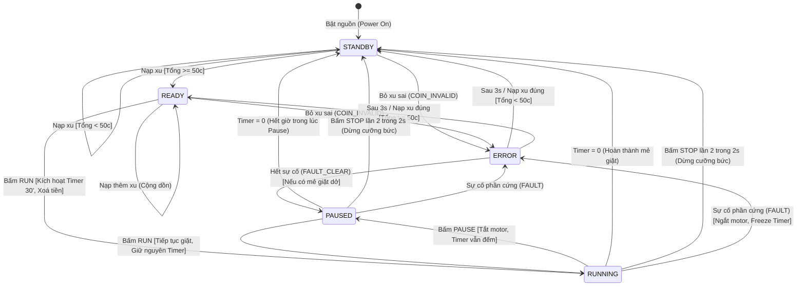

# BÁO CÁO THIẾT KẾ FSM VÀ MÃ GIẢ (PSEUDOCODE)
## HỆ THỐNG ĐIỀU KHIỂN MÁY GIẶT TỰ ĐỘNG (CO3053 - HỆ THỐNG NHÚNG)

---

## 1. TỔNG QUAN HỆ THỐNG VÀ THÔNG SỐ ĐẦU VÀO / ĐẦU RA

### 1.1. Cổng vào (Inputs)
- **3 nút nhấn điều khiển (Buttons):**
  - `STOP`: Yêu cầu dừng máy (nhấn 2 lần trong vòng 2 giây để dừng cưỡng bức).
  - `RUN`: Yêu cầu khởi động chu trình giặt khi đủ tiền hoặc tiếp tục giặt khi đang tạm dừng.
  - `PAUSE`: Tạm dừng quá trình giặt (timer vẫn tiếp tục đếm lùi).
- **Bộ nhận tiền xu (Coin Acceptor):**
  - Chấp nhận 3 loại mệnh giá hợp lệ: `10-cent`, `20-cent`, `50-cent`.
  - Phát hiện xu lạ / xu giả / mệnh giá khác: phát sinh sự kiện `COIN_INVALID`.
- **Cảm biến an toàn (Hardware Fault Sensor):**
  - Phát hiện sự cố vật lý: hở cửa máy giặt, mất áp lực nước, quá nhiệt...

### 1.2. Cổng ra (Outputs)
- **RLED (Red LED):**
  - Sáng liên tục (`ON`): Máy ở chế độ chờ phục vụ (`STANDBY`).
  - Nhấp nháy (`BLINK`, chu kỳ 1 Hz): Máy gặp sự cố (`ERROR` do xu sai hoặc lỗi phần cứng).
- **BLED (Blue LED):**
  - Sáng liên tục (`ON`): Sẵn sàng thực thi (`READY`) hoặc đang tạm dừng chờ giặt tiếp (`PAUSED`).
  - Nhấp nháy (`BLINK`, chu kỳ 1 Hz): Máy đang vận hành chu trình giặt (`RUNNING`).
- **Motor giặt:**
  - `ON`: Quay lồng giặt (khi ở `RUNNING`).
  - `OFF`: Tắt motor (ở mọi trạng thái khác).

---

## 2. THIẾT KẾ MÁY TRẠNG THÁI HỮU HẠN (FSM)

### 2.1. Danh sách trạng thái (States)
1. `STANDBY` (Trạng thái chờ ban đầu): Chưa đủ tiền (< 50c), máy sẵn sàng nhận tiền. RLED bật sáng, BLED tắt.
2. `READY` (Trạng thái sẵn sàng): Tiền tích lũy ≥ 50c. RLED tắt, BLED bật sáng, chờ nhấn `RUN`.
3. `RUNNING` (Trạng thái đang giặt): Động cơ quay, timer 30 phút đếm lùi, BLED nhấp nháy, RLED tắt.
4. `PAUSED` (Trạng thái tạm dừng): Động cơ dừng, **timer vẫn tiếp tục đếm lùi**, BLED bật sáng, RLED tắt.
5. `ERROR` (Trạng thái báo lỗi): RLED nhấp nháy, động cơ tắt, BLED tắt. Gồm lỗi xu lạ (tự phục hồi sau 3s) và lỗi phần cứng (chờ sửa xong).

---

### 2.2. Sơ đồ trạng thái (Mermaid FSM Diagram)



---

### 2.3. Bảng chân trị trạng thái & đầu ra (Output Truth Table)

| Trạng thái (State) | RLED | BLED | Motor | Khe nhận xu | Ý nghĩa hoạt động |
|---|:---:|:---:|:---:|:---:|---|
| **STANDBY** | **ON** | OFF | OFF | Nhận xu | Sẵn sàng phục vụ, chờ khách bỏ đủ tiền |
| **READY** | OFF | **ON** | OFF | Nhận xu | Đã nạp đủ tiền (≥ 50c), sẵn sàng bấm `RUN` |
| **RUNNING** | OFF | **BLINK (1Hz)** | **ON** | Khóa (Trả xu) | Đang thực hiện chu trình giặt, timer đếm lùi |
| **PAUSED** | OFF | **ON** | OFF | Khóa (Trả xu) | Đang tạm dừng, **timer vẫn tiếp tục đếm lùi** |
| **ERROR** (Xu lạ) | **BLINK (1Hz)** | OFF | OFF | Nhận xu | Báo động xu không hợp lệ, tự tắt sau 3 giây |
| **ERROR** (Lỗi phần cứng) | **BLINK (1Hz)** | OFF | OFF | Khóa (Trả xu) | Khẩn cấp: ngắt motor, đóng băng timer bảo vệ |

---

### 2.4. Bảng chuyển trạng thái chi tiết (State Transition Table)

| Trạng thái hiện tại | Sự kiện kích hoạt (Event) | Điều kiện kích hoạt (Guard Condition) | Trạng thái kế tiếp | Hành động kích hoạt (Actions / Output Updates) |
|---|---|---|---|---|
| **STANDBY** | `COIN_10 / 20 / 50` | `Credit + Coin < 50` | `STANDBY` | `Credit += Coin` |
| **STANDBY** | `COIN_10 / 20 / 50` | `Credit + Coin >= 50` | `READY` | `Credit += Coin`, Bật BLED, Tắt RLED |
| **STANDBY** | `COIN_INVALID` | – | `ERROR` | `ErrorType = INVALID_COIN`, `ErrorTimer = 3s`, RLED chớp |
| **STANDBY** | `RUN / PAUSE / STOP` | – | `STANDBY` | Bỏ qua sự kiện (Không có tác dụng) |
| **READY** | `COIN_10 / 20 / 50` | `Credit + Coin <= 990` | `READY` | `Credit += Coin` (Cộng dồn không trả dư) |
| **READY** | `BTN_RUN` | – | `RUNNING` | `WashTimer = 30 min`, `Credit = 0`, Bật Motor, BLED chớp |
| **READY** | `COIN_INVALID` | – | `ERROR` | Báo lỗi 3s, giữ nguyên số tiền nạp |
| **RUNNING** | `BTN_PAUSE` | – | `PAUSED` | Tắt Motor, BLED chuyển sang sáng đứng |
| **RUNNING** | `BTN_STOP` | `StopArmed == False` | `RUNNING` | `StopArmed = True`, `StopWindow = 2s` |
| **RUNNING** | `BTN_STOP` | `StopArmed == True` | `STANDBY` | Tắt Motor, `WashTimer = 0`, Force Stop thành công |
| **RUNNING** | `TICK (Timer == 0)` | `WashTimer == 0` | `STANDBY` | Tắt Motor, Hoàn thành 30' (COMPLETED) |
| **RUNNING** | Bỏ xu bất kỳ | – | `RUNNING` | Trả lại xu ngay (Không nhận xu khi đang giặt) |
| **PAUSED** | `BTN_RUN` | – | `RUNNING` | Bật Motor, BLED chớp, tiếp tục đếm lùi timer |
| **PAUSED** | `BTN_STOP` | `StopArmed == True` | `STANDBY` | Hủy chu trình ngay lập tức, về STANDBY |
| **PAUSED** | `TICK (Timer == 0)` | `WashTimer == 0` | `STANDBY` | Hết 30' ngay trong lúc tạm dừng, về STANDBY |
| **ERROR** | `TICK (3s elapsed)` | `ErrorType == INVALID_COIN` | `STANDBY / READY` | Tự động hồi phục theo số tiền hiện có |
| **Bất kỳ** | `FAULT` (Sự cố) | Cửa mở / Mất nước | `ERROR` | Dừng khẩn cấp motor, bảo lưu `WashTimer` |
| **ERROR** | `FAULT_CLEAR` | Sự cố đã khắc phục | `PAUSED` (nếu đang giặt dở) / `STANDBY` | Khôi phục an toàn, chờ người dùng bấm RUN tiếp |

---

## 3. THIẾT KẾ MÃ GIẢ (PSEUDOCODE)

Hệ thống được thiết kế theo mô hình **Time-Triggered Embedded Architecture** với chu kỳ lấy mẫu và cập nhật trạng thái cố định $T_{tick} = 10\text{ ms}$.

### 3.1. Cấu trúc dữ liệu và hằng số cấu hình

```pascal
CONSTANTS:
    TICK_PERIOD_MS       = 10              // Chu kỳ ngắt timer 10ms
    WASH_DURATION_TICKS  = 30 * 60 * 100   // 30 phút = 180,000 ticks
    BLINK_HALF_TICKS     = 50              // 500ms đảo pha LED 1 lần (1Hz)
    STOP_WINDOW_TICKS    = 200             // Cửa sổ bấm STOP lần 2: 2 giây
    COIN_ERROR_TICKS     = 300             // Báo lỗi xu lạ trong 3 giây
    MIN_CREDIT_CENTS     = 50              // Tiền tối thiểu để chạy: 50 cents
    DEBOUNCE_STABLE_N    = 3               // Lọc dội phím: 3 mẫu liên tục (30ms)

DATA TYPES:
    ENUM State: {STANDBY, READY, RUNNING, PAUSED, ERROR}
    ENUM ErrorType: {ERR_NONE, ERR_INVALID_COIN, ERR_HW_FAULT}
    ENUM ButtonID: {BTN_STOP, BTN_RUN, BTN_PAUSE}

STRUCTURE ControllerContext:
    state           : State
    credit          : Integer
    washTimer       : Integer (ticks)
    errorType       : ErrorType
    errorTimer      : Integer (ticks)
    stopArmed       : Boolean
    stopTimer       : Integer (ticks)
    blinkPhase      : Boolean
    blinkCounter    : Integer
```

---

### 3.2. Thuật toán khởi tạo hệ thống (Initialization)

```pascal
PROCEDURE System_Init():
    Context.state        := STANDBY
    Context.credit       := 0
    Context.washTimer    := 0
    Context.errorType    := ERR_NONE
    Context.errorTimer   := 0
    Context.stopArmed    := FALSE
    Context.stopTimer    := 0
    Context.blinkPhase   := TRUE
    Context.blinkCounter := 0
    
    // Khởi tạo trạng thái I/O ban đầu
    HAL_Write_RLED(HIGH)       // RLED ON khi ở Standby
    HAL_Write_BLED(LOW)        // BLED OFF
    HAL_Write_Motor(LOW)       // Motor OFF
    Initialize_Debounce_Filters()
END PROCEDURE
```

---

### 3.3. Thuật toán bộ lọc chống dội nút bấm (Debouncer)

```pascal
PROCEDURE Update_Debounce(filter, rawPinLevel) -> EdgeDetected:
    IF rawPinLevel == filter.stableLevel THEN
        filter.sampleCount := 0
        RETURN NO_EDGE
    ELSE
        filter.sampleCount := filter.sampleCount + 1
        IF filter.sampleCount >= DEBOUNCE_STABLE_N THEN
            filter.stableLevel := rawPinLevel
            filter.sampleCount := 0
            IF filter.stableLevel == ACTIVE THEN
                RETURN PRESS_EDGE
            ELSE
                RETURN RELEASE_EDGE
            END IF
        END IF
        RETURN NO_EDGE
    END IF
END PROCEDURE
```

---

### 3.4. Vòng lặp điều khiển thời gian thực (Time-Triggered Tick: 10ms)

```pascal
// Hàm được gọi định kỳ chính xác mỗi 10ms từ Ngắt phần cứng (Timer ISR)
PROCEDURE Main_Periodic_Tick():
    // BƯỚC 1: LẤY MẪU VÀ CHỐNG DỘI PHẦN CỨNG
    faultRaw  := HAL_Read_Fault_Sensor()
    faultEdge := Update_Debounce(FaultFilter, faultRaw)
    IF faultEdge == PRESS_EDGE THEN
        Dispatch_Event(EV_FAULT)
    ELSE IF faultEdge == RELEASE_EDGE THEN
        Dispatch_Event(EV_FAULT_CLEAR)
    END IF

    coinValue := HAL_Read_Coin_Slot()
    IF coinValue IN [10, 20, 50] THEN
        Dispatch_Event(EV_COIN, coinValue)
    ELSE IF coinValue > 0 THEN
        Dispatch_Event(EV_COIN_INVALID)
    END IF

    FOR each btn IN [BTN_STOP, BTN_PAUSE, BTN_RUN] DO
        btnEdge := Update_Debounce(ButtonFilter[btn], HAL_Read_Button(btn))
        IF btnEdge == PRESS_EDGE THEN
            Dispatch_Event(ButtonToEvent(btn))
        END IF
    END FOR

    // BƯỚC 2: CẬP NHẬT CÁC BỘ ĐẾM THỜI GIAN (TIMERS)
    // 2.1 Bộ tạo xung nhấp nháy 1Hz (500ms ON / 500ms OFF)
    Context.blinkCounter := Context.blinkCounter + 1
    IF Context.blinkCounter >= BLINK_HALF_TICKS THEN
        Context.blinkCounter := 0
        Context.blinkPhase   := NOT Context.blinkPhase
    END IF

    // 2.2 Đếm lùi chu trình giặt 30 phút (kể cả khi RUNNING và PAUSED)
    IF Context.state == RUNNING OR Context.state == PAUSED THEN
        // Xử lý timeout cửa sổ 2 giây cho nút STOP
        IF Context.stopArmed THEN
            Context.stopTimer := Context.stopTimer - 1
            IF Context.stopTimer <= 0 THEN
                Context.stopArmed := FALSE   // Quá 2s không nhấn STOP lần 2 -> hủy
            END IF
        END IF

        // Đếm lùi thời gian giặt
        IF Context.washTimer > 0 THEN
            Context.washTimer := Context.washTimer - 1
            IF Context.washTimer == 0 THEN
                // Hết 30 phút -> Kết thúc chu trình tự động
                Context.state     := STANDBY
                Context.stopArmed := FALSE
            END IF
        END IF
    END IF

    // 2.3 Đếm lùi lỗi xu lạ 3 giây
    IF Context.state == ERROR AND Context.errorType == ERR_INVALID_COIN THEN
        Context.errorTimer := Context.errorTimer - 1
        IF Context.errorTimer <= 0 THEN
            Context.errorType := ERR_NONE
            IF Context.credit >= MIN_CREDIT_CENTS THEN
                Context.state := READY
            ELSE
                Context.state := STANDBY
            END IF
        END IF
    END IF

    // BƯỚC 3: CẬP NHẬT CÁC CỔNG XUẤT (OUTPUT DRIVER)
    Update_Physical_Outputs()
END PROCEDURE
```

---

### 3.5. Hàm xử lý logic chuyển trạng thái FSM (Event Dispatcher)

```pascal
PROCEDURE Dispatch_Event(event, param):
    // XỬ LÝ KHẨN CẤP: LỖI PHẦN CỨNG ƯU TIÊN CAO NHẤT
    IF event == EV_FAULT THEN
        Context.state     := ERROR
        Context.errorType := ERR_HW_FAULT
        Context.stopArmed := FALSE
        RETURN
    ELSE IF event == EV_FAULT_CLEAR THEN
        IF Context.state == ERROR AND Context.errorType == ERR_HW_FAULT THEN
            Context.errorType := ERR_NONE
            IF Context.washTimer > 0 THEN
                Context.state := PAUSED   // Giặt dở thì về PAUSED chờ người bấm RUN
            ELSE IF Context.credit >= MIN_CREDIT_CENTS THEN
                Context.state := READY
            ELSE
                Context.state := STANDBY
            END IF
        END IF
        RETURN
    END IF

    // XỬ LÝ THEO MA TRẬN TRẠNG THÁI HIỆN TẠI
    SWITCH Context.state DO:
        CASE STANDBY:
            IF event == EV_COIN THEN
                Context.credit := Context.credit + param
                IF Context.credit >= MIN_CREDIT_CENTS THEN
                    Context.state := READY
                END IF
            ELSE IF event == EV_COIN_INVALID THEN
                Context.state      := ERROR
                Context.errorType  := ERR_INVALID_COIN
                Context.errorTimer := COIN_ERROR_TICKS
                Reject_Coin()
            END IF
            // Các nút RUN, PAUSE, STOP bị bỏ qua khi đang ở Standby

        CASE READY:
            IF event == EV_COIN THEN
                Context.credit := Context.credit + param   // Cho phép cộng dồn thêm
            ELSE IF event == EV_COIN_INVALID THEN
                Context.state      := ERROR
                Context.errorType  := ERR_INVALID_COIN
                Context.errorTimer := COIN_ERROR_TICKS
                Reject_Coin()
            ELSE IF event == EV_BTN_RUN THEN
                // BẮT ĐẦU CHU TRÌNH GIẶT
                Context.credit    := 0                     // Xóa tiền, không trả thừa
                Context.washTimer := WASH_DURATION_TICKS   // Kích hoạt Timer 30 phút
                Context.stopArmed := FALSE
                Context.state     := RUNNING
            END IF

        CASE RUNNING:
            IF event == EV_COIN OR event == EV_COIN_INVALID THEN
                Reject_Coin()                              // Khóa khe xu khi đang giặt
            ELSE IF event == EV_BTN_PAUSE THEN
                Context.stopArmed := FALSE
                Context.state     := PAUSED                // Tạm dừng, timer vẫn đếm
            ELSE IF event == EV_BTN_STOP THEN
                IF Context.stopArmed == TRUE THEN
                    // BẤM LẦN 2 TRONG VÒNG 2 GIÂY -> DỪNG CƯỠNG BỨC
                    Context.washTimer := 0
                    Context.stopArmed := FALSE
                    Context.state     := STANDBY
                ELSE
                    // BẤM LẦN 1 -> BẬT CHẾ ĐỘ CHỜ XÁC NHẬN
                    Context.stopArmed := TRUE
                    Context.stopTimer := STOP_WINDOW_TICKS
                END IF
            END IF

        CASE PAUSED:
            IF event == EV_COIN OR event == EV_COIN_INVALID THEN
                Reject_Coin()
            ELSE IF event == EV_BTN_RUN THEN
                Context.stopArmed := FALSE
                Context.state     := RUNNING               // Tiếp tục giặt, timer giữ nguyên
            ELSE IF event == EV_BTN_STOP THEN
                IF Context.stopArmed == TRUE THEN
                    Context.washTimer := 0
                    Context.stopArmed := FALSE
                    Context.state     := STANDBY
                ELSE
                    Context.stopArmed := TRUE
                    Context.stopTimer := STOP_WINDOW_TICKS
                END IF
            END IF

        CASE ERROR:
            IF Context.errorType == ERR_INVALID_COIN THEN
                IF event == EV_COIN THEN
                    // Nhập xu hợp lệ giải phóng ngay trạng thái lỗi
                    Context.credit    := Context.credit + param
                    Context.errorType := ERR_NONE
                    IF Context.credit >= MIN_CREDIT_CENTS THEN
                        Context.state := READY
                    ELSE
                        Context.state := STANDBY
                    END IF
                ELSE IF event == EV_COIN_INVALID THEN
                    Context.errorTimer := COIN_ERROR_TICKS  // Bỏ xu lạ liên tục -> reset 3s
                    Reject_Coin()
                END IF
            END IF
    END SWITCH
END PROCEDURE
```

---

### 3.6. Điều khiển cổng xuất vật lý (Hardware Output Driver)

```pascal
PROCEDURE Update_Physical_Outputs():
    // 1. Điều khiển RLED
    IF Context.state == STANDBY THEN
        HAL_Write_RLED(HIGH)
    ELSE IF Context.state == ERROR THEN
        HAL_Write_RLED(Context.blinkPhase ? HIGH : LOW)
    ELSE
        HAL_Write_RLED(LOW)
    END IF

    // 2. Điều khiển BLED
    IF Context.state == READY OR Context.state == PAUSED THEN
        HAL_Write_BLED(HIGH)
    ELSE IF Context.state == RUNNING THEN
        HAL_Write_BLED(Context.blinkPhase ? HIGH : LOW)
    ELSE
        HAL_Write_BLED(LOW)
    END IF

    // 3. Điều khiển Motor
    IF Context.state == RUNNING THEN
        HAL_Write_Motor(HIGH)
    ELSE
        HAL_Write_Motor(LOW)
    END IF
END PROCEDURE
```

---

## 4. ĐẶC ĐIỂM KỸ THUẬT VÀ TÍNH TỐI ƯU CỦA THIẾT KẾ

1. **Tính tiền định thời gian (Deterministic Real-Time Execution):**
   - Mọi hàm trong FSM đều có độ phức tạp thuật toán là thời gian hằng số $\mathcal{O}(1)$.
   - Không chứa bất kỳ vòng lặp chờ (`while/for blocking`), hoàn toàn thích hợp chạy trực tiếp trong ngắt hoặc hàm gọi chu kỳ 10ms.
2. **Không cấp phát động (Zero Dynamic Memory):**
   - Không sử dụng `malloc/free`, loại bỏ 100% rủi ro tràn heap hoặc phân mảnh bộ nhớ vi điều khiển.
3. **Bộ lọc chống dội phần cứng (Software Debouncing):**
   - Nút bấm cơ khí được lấy mẫu liên tục; chỉ kích hoạt sự kiện khi mức logic duy trì ổn định đủ 30ms, chống kích hoạt sai do tia lửa điện hoặc rung tiếp điểm.
4. **Cơ chế an toàn 2 lần nhấn STOP (Double-tap Safety):**
   - Tránh việc người dùng vô tình va quẹt làm dừng gián đoạn mẻ giặt; chuỗi chỉ được chấp nhận nếu nhấn lại lần 2 trong khoảng thời gian định trước (2 giây).
5. **Công bằng và bảo vệ tài chính:**
   - Khi máy đã vào chu trình giặt hoặc lỗi, khe nhận xu tự động từ chối tiền đưa vào để bảo vệ khách hàng.
   - Khi mẻ giặt bắt đầu, toàn bộ tiền dư được giải phóng theo đúng yêu cầu đề bài.
